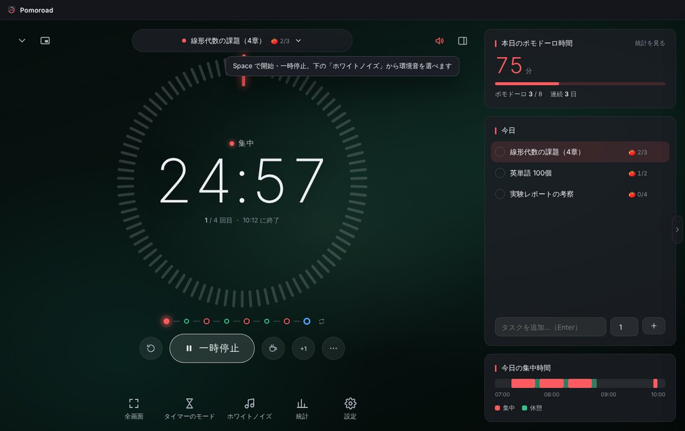
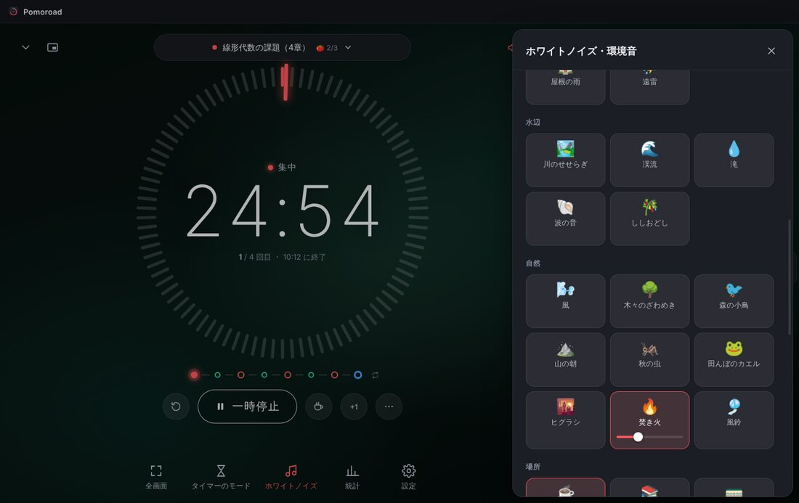
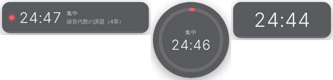
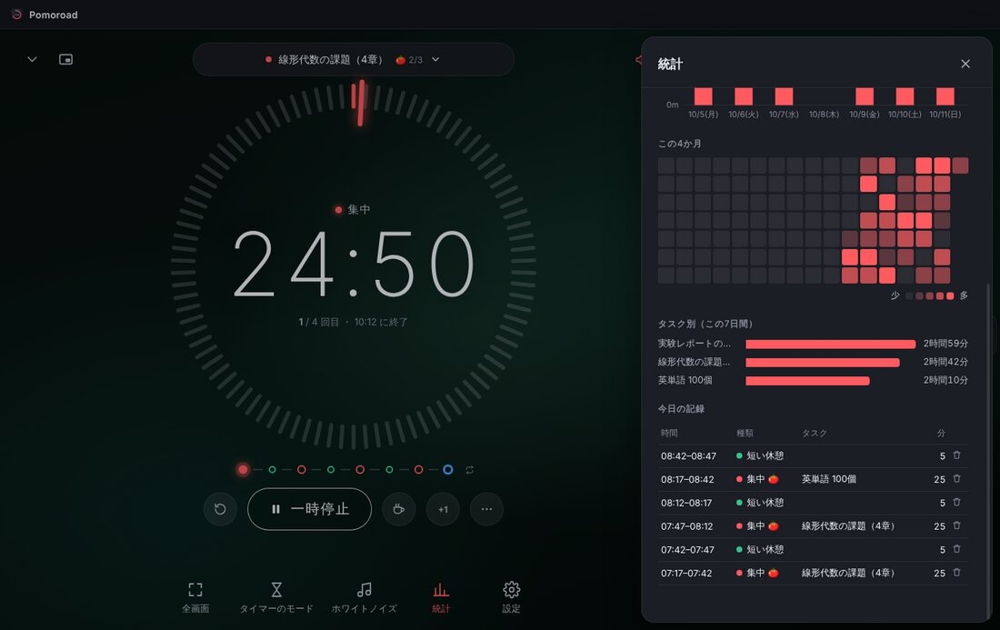

# Pomoroad（ポモロード）

自由に組み立てられるポモドーロタイマー。Windows アプリ。
集中と休憩の並び（ロード）を好きなように組めて、37 種類の環境音（ホワイトノイズ・雨・喫茶店・図書館・山・川・海など）を重ねて鳴らせます。



---

## ダウンロードとインストール（Windows）

1. このリポジトリの **Actions** タブ →「**Build Windows app**」→ 一番上の実行（緑のチェック）を開く
2. ページ下の **Artifacts** にある `Pomoroad-Windows` をダウンロードして、zip を展開
3. どちらかを実行
   - `Pomoroad-Setup-1.0.0.exe` … インストール版（スタートメニューとデスクトップにショートカットができます）
   - `Pomoroad-1.0.0-portable.exe` … インストール不要。どこに置いても動きます

> 署名をしていないので、初回は「Windows によって PC が保護されました」と出ます。
> 「**詳細情報**」→「**実行**」で起動できます。

---

## できること

### タイマー

| | |
|---|---|
| モード | **ポモドーロ**（時間を決める）／**フロータイム**（集中は計るだけ、休憩は集中時間の 1/5）／**ストップウォッチ** |
| 並び方（シンプル） | 集中・短い休憩・長い休憩の長さ、**長い休憩を何回ごとにとるか**（0 で長い休憩なし）、1 セットの回数、**最初を休憩から始めるか**（準備の 5 分など）、セットの最後の休憩、くり返すかどうか |
| 並び方（カスタム） | ステップを 1 つずつ好きな順番・長さで並べる（例：休憩 5 分 → 集中 25 分 → … → 長い休憩 20 分）。メモも付けられる |
| プリセット | クラシック 25/5・休憩から始める・ディープワーク 50/10・52/17 ルール・90/20 ウルトラディアン・試験演習 60/10・ショート 15/3・フロータイム・ストップウォッチ。自分の設定も名前を付けて保存できる |
| ロード | 画面下の点の列が今日の流れ。**点をクリックすると、そのステップへ移動・種類の変更・長さの変更・前後に追加・削除**がその場でできる |

途中の操作もいろいろできます。

- **一時停止したところから**「ここで切り上げて休憩に入る」「長い休憩に入る」「次へスキップ」
- 休憩中に「休憩をスキップして集中へ」「長い休憩に切り替える」
- 「今すぐ短い休憩／長い休憩をとる」、+1 分・+5 分・−1 分、**残り時間を分単位で指定**
- このステップをやり直す、最初からやり直す、ロードの好きな位置へジャンプ
- 休憩・集中をそれぞれ自動で始めるか、**時間切れのあとも数え続ける**（+01:23 のように表示して記録にも入れる）
- 途中で切り上げたとき、何％以上ならポモドーロ 1 回に数えるか
- **厳格モード**（集中中は一時停止・スキップを隠す）
- 「気が散った」の記録（D キー）

### ホワイトノイズ・環境音（37 種類 ＋ 自分の音源）

| 分類 | 音 |
|---|---|
| ノイズ | ホワイト・ピンク・ブラウン・ディープブラウン・グリーンノイズ、扇風機、飛行機の機内 |
| 雨 | 小雨、本降りの雨、窓に当たる雨、屋根の雨、遠雷 |
| 水辺 | 川のせせらぎ、渓流、滝、波の音、ししおどし |
| 自然 | 風、木々のざわめき、森の小鳥、山の朝（ウグイス・カッコウ）、秋の虫、田んぼのカエル、ヒグラシ、焚き火、風鈴 |
| 場所 | 喫茶店、図書館（ページをめくる音・鉛筆・足音）、電車 |
| 作業音 | 時計の音、タイピング、鉛筆で書く音、レコードのノイズ |
| トーン | アンビエント（やわらかい和音）、バイノーラル α 波・β 波・γ 波 |

- いくつでも重ねられて、音ごとに音量を変えられる
- **シーン**：雨の喫茶店・静かな図書館・山の朝・海辺・森林浴・夏の夜・秋の夜長・嵐の夜・冬の山小屋・日本庭園・夜行列車・自習室・Lo-fi 勉強部屋・深い集中。自分の組み合わせも保存できる
- タイマーとの連動：**連動しない／集中中だけ鳴らす／集中と休憩で別の音**。切り替えはフェード
- 手元の音声ファイル（mp3・wav など）を追加して混ぜられる
- **雨や自然の音は、ループではなく続きを作り続けている**ので、同じところのくり返しになりません。
  雨の強さ・音の近さ・「ザー」と「ぽつぽつ」の割合、風の強さ、川の流れ、海の荒れ具合などが**数分かけてゆっくり移り変わります**
  （変わり方の大きさは「一定／ひかえめ／ふつう／大きめ」から選べる）
- 鳥は「やって来て、同じ場所でしばらく鳴いて、去っていく」ように鳴き、雷・虫・カエルなども、にぎやかな時間と静かな時間が交互に来ます
- 喫茶店の話し声は、日本語の音声合成で作った会話を何十人分も重ねたもの（言葉は聞き取れない程度）。長い録音の中をランダムに飛びながら再生するので、くり返しが目立ちません
- オフラインで使えます（ノイズ・雨・自然の音はアプリの中で合成、話し声はアプリに同梱）



### ミニ表示（常に手前に出る小さなタイマー）



- 横長・円・数字だけの 3 つの形。大きさ・不透明度・背景の濃さを変えられる
- **全画面のアプリ（動画など）より手前**にも出せる。ドラッグで好きな場所へ
- メイン画面を最小化したら自動でミニ表示にする、などの設定つき
- 左上の「∨」でミニ表示にしてメイン画面をしまう、「⧉」でミニ表示を出す／消す

### 全画面

集中のための全画面表示。マウスを止めるとボタンが消えて、時計とタイマーだけになります。

### 通知と音

- 集中の終わり・休憩の終わりの音を別々に（学校のチャイム・ベル・マリンバ・オルゴール・カリンバ・シンギングボウル・風鈴・小鳥・デジタルなど）
- 終わる前の予告音（1〜5 分前）、秒針の音（集中中だけ／最後の 1 分だけ など）
- 音声で読み上げ（「集中おつかれさまでした。5 分休憩しましょう」）
- Windows の通知、タスクバーの点滅、終わったらウィンドウを前に出す

### 記録と統計



- 本日のポモドーロ時間、目標の進み具合、連続日数、今日の集中のタイムライン
- 日ごとの棒グラフ（7・14・30 日）、4 か月のカレンダー、タスク別の時間、今日の記録の一覧（間違えた記録は消せる）
- バックアップ（JSON）の保存と読み込み、**CSV（Excel で開ける）**の書き出し
- 1 日の区切りの時刻（夜ふかしした分を前の日に数える）

### タスク

今日のタスクを追加して、上の欄から「集中するタスク」を選べます。見積もりのポモドーロ数と、実際に終わった数・集中した時間がタスクごとに残ります。

### 見た目

ダーク／ライト、背景（森・夜空・動くオーロラ・動く星空・深い海・夕暮れ・無地・和紙・**自分の画像**）、暗さ・ぼかし、雨・雪・ホタルの演出（環境音に合わせて自動でも）、段階ごとの色、数字の書体、リングの形（目盛り・線・点）と向き、秒の表示、終わる時刻の表示。

### Windows との連携

- タスクトレイに常駐（アイコンが進み具合のリングになる）、×ボタンでトレイにしまう
- タスクバーのボタンに進み具合を表示
- **どのアプリを使っていても効くショートカット**（初期値：`Ctrl+Alt+Space` 開始/一時停止、`Ctrl+Alt+→` スキップ、`Ctrl+Alt+M` ミニ表示、`Ctrl+Alt+P` メイン画面）
- 画面ロック・スリープで自動一時停止、**離席を検出して一時停止**（触っていなかった時間は記録から除く）
- Windows の起動時に開く

---

## キーボード（アプリの中）

| キー | 動き |
|---|---|
| `Space` | 開始・一時停止 |
| `N` | 次へスキップ |
| `B` | 今すぐ休憩 |
| `R` | このステップをやり直す |
| `+` / `Shift` + `+` | 1 分・5 分のばす |
| `-` | 1 分へらす |
| `D` | 気が散ったを記録 |
| `F` | 全画面 |
| `M` | ミニ表示 |
| `W` | 環境音のパネル |
| `S` | 統計 |
| `Esc` | パネルを閉じる・全画面を終える |

設定の「ショートカット」で全部変えられます。

---

## 自分で動かす・改造する

[Node.js](https://nodejs.org/)（22 以降）を入れてから、PowerShell でこのフォルダを開いて実行します。

```powershell
npm install
npm start
```

| コマンド | 内容 |
|---|---|
| `npm start` | アプリを起動 |
| `npm test` | タイマーの動きのテスト |
| `npm run dist` | Windows 用のインストーラーとポータブル版を `dist` フォルダに作る |
| `npm run web` | ブラウザ版を http://localhost:5173 で開く（ミニ表示は Chrome / Edge のピクチャーインピクチャー） |
| `npm run sounds` | 環境音をすべて WAV にして `scratch/sounds` に書き出す（音の調整用） |

### フォルダ

```
electron/        Windows アプリの部分（ウィンドウ・トレイ・ミニ表示・ショートカット）
src/             画面（ブラウザでもそのまま動く）
  js/core/       タイマー本体・並び・記録・設定の保存
  js/audio/      環境音（streams.js：移り変わる雨・自然の音, beds.js：一定の音, oneshots.js：鳥や雷などの単発音・通知音）
  assets/sounds/ 喫茶店の話し声
  js/ui/         画面の部品
tests/           タイマーのテスト
docs/ideas.md    集めたアイデアと、次に足せそうなもの
```

環境音を足したいときは、移り変わる音なら `src/js/audio/streams.js`、一定の音なら `src/js/audio/beds.js` に合成のしかたを書いて、`src/js/audio/catalog.js` の一覧に 1 行足します。
新しいストリームの音量は `node scripts/calibrate-streams.mjs` で測って `norm` に書きます。

喫茶店の話し声（`src/assets/sounds/cafe-voices.ogg`）は `scripts/make-cafe-voices.py` で作り直せます（pyopenjtalk・numpy・scipy が必要）。

---

## クレジット

- 喫茶店の話し声：音声合成エンジン [Open JTalk](https://open-jtalk.sourceforge.net/)（修正 BSD ライセンス）、
  HTS Voice「Mei」（© 2009-2013 Nagoya Institute of Technology, Department of Computer Science / MMDAgent Project Team、
  [CC BY 3.0](https://creativecommons.org/licenses/by/3.0/)）で作った音声を加工・合成
- そのほかの音（ノイズ・雨・自然・生活音・通知音）は、すべてこのアプリのプログラムで合成しています
